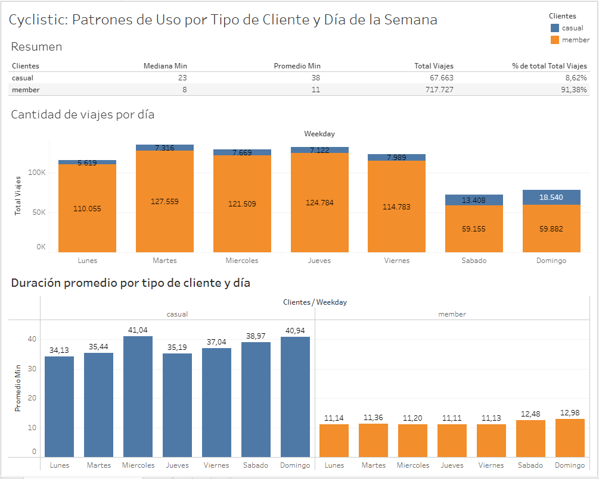

# 🚲 Cyclistic Bike-Share Analysis: Members vs. Casual Riders

## 📌 Resumen del Proyecto
Este proyecto analiza los patrones de comportamiento de los usuarios del sistema de bicicletas compartidas **Cyclistic** con el objetivo de identificar diferencias clave entre los **miembros anuales (`member`)** y los **usuarios ocasionales (`casual`)**, y proponer estrategias basadas en datos para convertir usuarios ocasionales en suscriptores anuales.

- **Herramientas utilizadas:** Python (Pandas) en Google Colab para limpieza, transformación y agregación de datos; Tableau Public para el diseño del dashboard interactivo.
- **Dashboard Interactivo:** [Ver visualización en Tableau Public](https://public.tableau.com/app/profile/bryan.toledo.donoso/viz/CyclisticBike-ShareAnalysisMembersvs_Casuals/CyclisticPatronesdeUsoporTipodeClienteyDadelaSemana)

---

## 🎯 Preguntas de Negocio
1. **¿En qué se diferencian los socios anuales y los ciclistas ocasionales al usar las bicicletas de Cyclistic?**
2. **¿Por qué los usuarios ocasionales comprarían membresías anuales de Cyclistic?**
3. **¿Cómo puede Cyclistic usar los medios digitales para influir en los usuarios ocasionales para que se conviertan en miembros?**

---

## ⚙️ Proceso de Preparación y Limpieza (Python / Pandas)
1. **Consolidación:** Integración de los registros históricos de viajes en un único DataFrame.
2. **Limpieza:** Eliminación de registros nulos, duplicados y viajes con duración inconsistente (negativa o cero).
3. **Ingeniería de características:**
   - Cálculo de la duración del viaje en minutos (`ride_length_min`).
   - Extracción del día de la semana (`weekday`) ordenado de lunes a domingo.
4. **Agregación:** Generación de tablas resumen (`resumen_usuario.csv` y `resumen_dias.csv`) para optimizar el rendimiento y la visualización en Tableau.

---

## 📊 Principales Hallazgos (Respuesta a Pregunta 1)

| Métrica | Casual | Member |
| :--- | :---: | :---: |
| **Total de Viajes** | 67.663 | 717.727 |
| **Participación (% del Total)** | 8,62% | 91,38% |
| **Duración Promedio** | 38 min | 11 min |
| **Duración Mediana** | 23 min | 8 min |

1. **Dominio de volumen por parte de los miembros:** Los usuarios `member` concentran el **91,38%** del total de viajes realizados, frente al **8,62%** de los usuarios `casual`.
2. **Uso laboral vs. uso recreativo:** Los `member` mantienen un volumen alto y estable de lunes a viernes (alcanzando su pico los martes con `127.559` viajes), lo que evidencia desplazamientos diarios (*commuting*)[cite: 9]. En cambio, los `casual` duplican su demanda durante el fin de semana (`13.408` viajes el sábado y `18.540` el domingo)[cite: 9].
3. **Mayor duración en viajes ocasionales:** La duración promedio de los usuarios `casual` (**38 minutos**, mediana de 23 min) triplica la de los `member` (**11 minutos**, mediana de 8 min), confirmando un uso recreativo o turístico más prolongado.

---

## 💡 Motivaciones de Conversión y Estrategia Digital

### 🔑 ¿Por qué los usuarios ocasionales comprarían membresías anuales? (Pregunta 2)
- **Ahorro económico en recorridos prolongados:** Dado que sus viajes duran en promedio más del triple que los de un socio anual (`38 min` vs. `11 min`), los usuarios ocasionales recurrentes incurren en tarifas acumuladas altas por tiempo de uso que una suscripción anual amortizaría rápidamente.
- **Conveniencia y disponibilidad constante:** Eliminar la fricción de comprar pases individuales cada fin de semana y contar con acceso ilimitado tanto para paseos recreativos como para traslados urbanos cortos.

### 📱 ¿Cómo puede Cyclistic usar los medios digitales para influir en los usuarios ocasionales para que se conviertan en miembros? (Pregunta 3)
Los datos muestran que los ciclistas ocasionales (`casual`) concentran su actividad durante los fines de semana (duplicando sus viajes el sábado y domingo) y realizan recorridos significativamente más largos que los socios anuales (`38 min` en promedio vs. `11 min`). Para capitalizar este comportamiento mediante canales digitales, Cyclistic debería ejecutar las siguientes acciones:

1. **Notificaciones *in-app* basadas en el ahorro por duración:** Activar alertas automáticas en la aplicación móvil cuando un usuario `casual` complete un viaje superior a 30 minutos o acumule varios recorridos en un mes, mostrándole exactamente cuánto dinero habría ahorrado con una membresía anual.
2. **Campañas de publicidad geolocalizada en fines de semana:** Concentrar la pauta digital (redes sociales y anuncios móviles) entre viernes por la tarde y domingo en torno a parques, zonas costeras y puntos turísticos, destacando la conveniencia y rentabilidad de suscribirse para quienes disfrutan paseos recreativos prolongados.
3. **Marketing por correo electrónico con beneficios de transición:** Implementar flujos automatizados de *email marketing* dirigidos a usuarios ocasionales recurrentes, ofreciendo promociones de prueba (como un primer mes con descuento o créditos adicionales por tiempo extendido).
4. **Contenido y retos comunitarios en redes sociales:** Utilizar Instagram y TikTok para promover rutas recreativas de fin de semana y desafíos de distancia o minutos acumulados exclusivos para miembros anuales, posicionando la suscripción no solo como un medio de transporte diario, sino como un pase de estilo de vida y recreación.

---

## 📂 Estructura del Repositorio
- `cyclistic_analysis.ipynb` — Notebook con limpieza, exploración y agregación en Python.
- `resumen_usuario.csv` — Tabla consolidada de KPIs globales por tipo de usuario.
- `resumen_dias.csv` — Tabla agregada de volumen y duración promedio por día de la semana.
- `dashboard_cyclistic.png` — Vista previa del dashboard publicado en Tableau Public.
